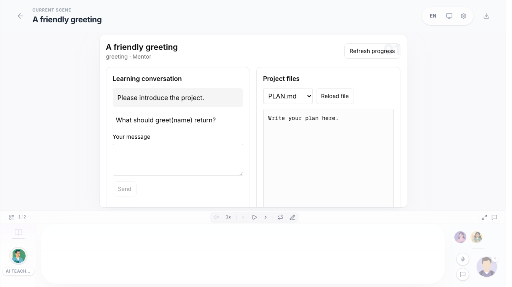
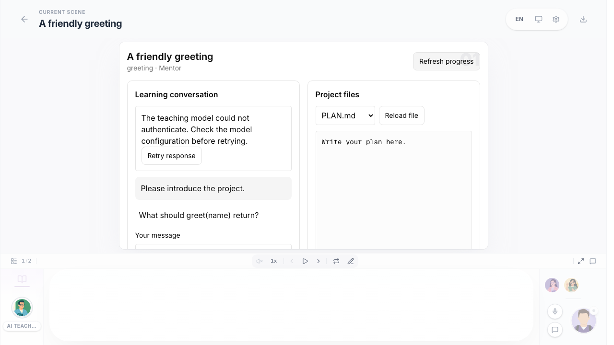

# PBL v3 learning runtime

This slice opens an installed programming project in the normal classroom, runs
four teaching roles in the existing Agent runner, and persists learning progress
in PostgreSQL. It does not enable generated v3 projects.

## Try the sample

Use the application's existing configuration:

- PostgreSQL through `DATABASE_URL`.
- `OPENMAIC_AGENT_RUNTIME_ENABLED=true` and a configured `agent` model slot.
- A configured shared sandbox provider and durable checkpoint storage.
- Explicit single-user installation mode, or a host-verified user with `sandbox:use`.

Open `/pbl-v3`, choose the Python sample, then prepare its project environment.
The configured sandbox template must have Python 3. Follow the teaching sections,
record a decision, review the plan and implementation, run and collect tests,
complete the quiz, and reflect with the mentor. Use **Continue** to confirm stage
progression. Use **Save checkpoint** to persist files separately from progress.

A PBL scene selects `{ projectV3: { id, version } }`. The server resolves that
reference against installed content. The scene never supplies model credentials,
executable test commands, answers, or authoritative learning state. Existing v1/v2
scenes keep their existing renderer.

## Execution and persistence

- `domain/` preserves the teaching state machine, artifact projection, decision
  records, quiz judging, and completion gates. Fixed model credentials and old
  host/release-upgrade orchestration are not used.
- `lib/server/pbl-v3/catalog.ts` contains the small public sample. Course assets
  are separate from the runtime. This slice deliberately exposes no arbitrary
  project upload or model-generated executable configuration.
- `lib/server/pbl-v3/store.ts` registers versioned PG migrations through the
  existing bootstrap mechanism. Study identity is unique per owner/classroom/scene;
  project version is pinned. State, ordered events and command receipts commit
  together. Remote operations retain request IDs for retry.
- Each role has a real durable Agent session. Mentor context spans the project;
  other roles are scoped to a milestone. A server-side binding selects the teaching
  prompt and tools in the existing runner. Teaching sessions do not receive course
  editing, browsing, media generation, or general shell tools.
- Role session IDs are reserved for the learning runtime. The ordinary chat list,
  status projection and event stream omit them, and the chat deletion server action
  refuses them. A previously deleted role is recreated on the next learning message;
  progress and files remain, while that role's review receipts restart.
- The runner owns leases, attempt fences, background execution, cancellation,
  durable messages and reconnection. There is no additional process or worker pool.
  Its existing concurrency limit applies; teaching runs are bounded to two minutes.
- Cancellation uses an owner-checked control path outside the learning lock and
  accepts stale progress revisions. Failed/cancelled turns have a visible status
  and an explicit retry through the existing runner. Retry reuses the original
  student message, so it cannot count as new feedback. Raw provider errors are
  replaced with fixed public failure categories.
- Role tools recheck binding, stage, owner, lease and expiring sandbox delegation.
  PLAN writes are restricted to planning. File writes compare an observed hash
  under the sandbox mutation lock. A pending write invalidates affected approvals
  before crossing the network.
- Guided review receipts require a later real student message and the same artifact
  digest. Completion signals cannot advance the stage. The server validates
  artifacts/tests, and the learner separately confirms progression. A committed
  review or completion receipt ends model execution even in a mixed tool batch.
  Retry/takeover preserves the wait and file-write restriction until a new student
  reply; a saved question remains visible even if its runner display event was lost.
- Tests run as sandbox background commands, with stable IDs and explicit result
  collection. Changed input invalidates the result; unknown execution is not a
  failed student test. Learning progress survives page refresh independently of
  the execution environment. File durability requires a successful checkpoint.
- Reflection receives the saved test status/feedback and tested workspace revision,
  plus the learner's quiz score and attempt summary. Internal diagnostics and
  answer keys are excluded from this evidence projection.
- The workspace rejects stale file-load responses after file selection changes.
  Quiz scores and retry guidance remain visible after refresh.

## Validation and remaining scope

`tests/pbl/v3/runtime.pg.test.ts` uses an isolated PostgreSQL schema, the real
runner/Pi loop, and real local Python execution through a test provider. It mocks
model transport and cloud provisioning; it is not live-cloud acceptance.

```sh
PG_CONTRACT_URL=postgres://... pnpm exec vitest run tests/pbl/v3/runtime.pg.test.ts
pnpm exec playwright test e2e/tests/pbl-v3-workspace.spec.ts
```

The browser spec checks classroom routing, controls and refresh using a mocked
learning API; it is separate from the PG/runner/execution test. Do not present the
two tests as a single live-provider end-to-end run.

The browser fixture after refreshing the normal classroom (model/cloud responses
are mocked in this UI test):



The same fixture with a failed teaching turn, restored after refresh:



The next slice completes the richer workspace (terminal and application preview),
cross-milestone sample acceptance, reports/exploration, and comprehensive recovery
including execution-environment replacement. The full course instance, operational
deployment, SSH adapter and project generation are not delivered by this slice.
